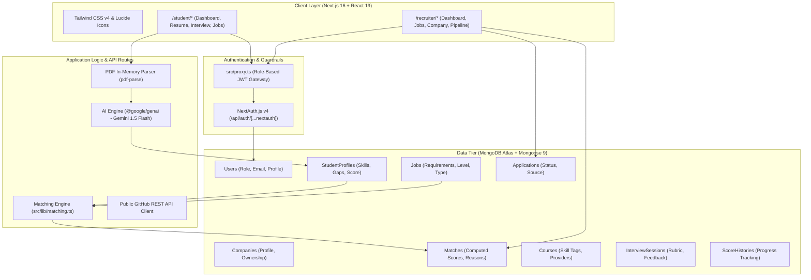

# 🚀 Workly — Match. Learn. Grow.

<div align="center">


[](https://nextjs.org/)
[](https://react.dev/)
[](https://www.typescriptlang.org/)
[](https://tailwindcss.com/)
[](https://www.mongodb.com/)
[](https://ai.google.dev/)
[](https://next-auth.js.org/)
[](https://vercel.com/)
[](LICENSE)

**An AI-powered, skills-first career acceleration and merit-based talent matching platform bridging ambitious students and forward-thinking recruiters.**

[🌐 Live Production Demo](https://workly-app-site-q39oi7pnw-ani579s-projects.vercel.app) • [📖 Documentation](#-table-of-contents) • [⚡ Quickstart](#-getting-started) • [👥 Meet the Team](#-the-team)

</div>

---

## 📑 Table of Contents

- [Overview & The Problem](#-overview--the-problem)
- [Key Features](#-key-features)
  - [🎓 For Students](#-for-students)
  - [💼 For Recruiters](#-for-recruiters)
- [System Architecture](#-system-architecture)
- [Tech Stack](#-tech-stack)
- [Project Structure](#-project-structure)
- [Getting Started](#-getting-started)
  - [Prerequisites](#prerequisites)
  - [Installation](#installation)
  - [Environment Variables](#environment-variables)
  - [Database Seeding](#database-seeding)
  - [Running the App](#running-the-app)
- [Verification & Test Suites](#-verification--test-suites)
- [Production Deployment](#-production-deployment-vercel)
  - [Required Production Environment Variables](#required-production-environment-variables)
  - [Google OAuth Setup](#google-oauth-setup)
- [Demo Credentials](#-preloaded-demo-credentials)
- [Privacy & Fair Hiring Principles](#-privacy--fair-hiring-principles)
- [The Team](#-the-team)
- [License](#-license)

---

## 💡 Overview & The Problem

Traditional campus hiring and job platforms are fundamentally broken:
- **Pedigree Bias:** Resume parsers and hiring managers disproportionately favor college brand names over demonstrated technical competency.
- **Inflated Scores & Generic Feedback:** Automated platforms provide arbitrary vanity percentiles without explaining actionable skill deficits.
- **Unstructured Learning:** Students are rejected without guidance on what to learn next to bridge the gap.

**Workly fixes this:**
1. **Objective Skills Extraction:** Analyzes technical resumes with Google Gemini AI into granular skill proficiency matrices and prioritized skill gaps.
2. **Curated Free Learning Paths:** Automatically queries and matches skill gaps against free, verified learning resources (Coursera, freeCodeCamp, edX, React.dev).
3. **Mathematical Match Scoring:** Transparent, explainable matching between candidates and real job requirements based on demonstrated abilities.
4. **Anonymous Recruiter Mode:** Hides candidate photos and names to enforce fair, merit-based hiring decisions.

---

## ✨ Key Features

### 🎓 For Students

- **In-Memory AI Resume Analysis:**
  - Fast, secure PDF text extraction using `@google/genai` (Gemini 1.5 Flash).
  - Multi-dimensional evaluation: Overall Score (0–100), key strengths, actionable improvements, and prioritized skill gaps.
  - Zero-disk storage policy: Uploaded files are processed strictly in RAM buffers and discarded immediately.
- **Tailored Free Course Recommendations:**
  - Real-time aggregation of 25+ free certified courses matching individual skill gaps.
- **AI Mock Interview Simulator:**
  - Interactive text-based technical interview assistant tailored to target roles and personal skill gaps.
  - Generates 5 role-specific situational and algorithmic questions.
  - Per-question scoring (0–10), instant rubric feedback, and expert model answers.
- **GitHub Read-Only Profile Import:**
  - Pulls public repositories, primary languages, and star counts via public GitHub REST API.
  - Merges external code contributions into the verified profile skills matrix.
- **Skill Progression & Score History:**
  - Interactive SVG visual trend chart mapping resume optimization over time.
  - Cohort percentile calculation computed strictly against stored database records.
- **Transparent Job Matching:**
  - Ranked job feed with clear "Why this match" breakdown and missing skill badges.
  - 1-click application submission with live status tracking.

### 💼 For Recruiters

- **Company Profile Management:**
  - Company branding, verified size, domain, and overview.
- **Smart Job Posting with Tag Normalization:**
  - Zod-validated job creation (title, location, role type, experience level, skill tags).
  - Automatically triggers background batch match computation for all evaluated student profiles.
- **Ranked Candidate Feed:**
  - Instant ranking of all candidate profiles sorted by compatibility score.
  - **Anonymous Mode Toggle:** Mask candidate names and avatars into `Candidate #<ID>` to eliminate unconscious bias during first-round screening.
  - Drill-down applicant modal showing verified skill badges, GitHub metrics, and missing requirements.
- **Applicant Pipeline & Shortlisting:**
  - Filter by *All Candidates*, *Applied*, and *Shortlisted*.
  - Real-time recruiter applicant counters powered by MongoDB aggregation pipelines.

---

## 🏛 System Architecture



---

## 🛠 Tech Stack

| Domain | Technology | Details |
| :--- | :--- | :--- |
| **Framework** | Next.js 16.4.0 (App Router) | Turbopack compiler, Server Components, Route Handlers |
| **Frontend** | React 19.3.0 | Next-gen hooks, transitions, client-side caching |
| **Styling** | Tailwind CSS v4 | CSS variables, modern utilities, zero-runtime overhead |
| **Database** | MongoDB Atlas & Mongoose 9.11.1 | Lean queries, indexed lookups, aggregation pipelines |
| **Authentication** | NextAuth.js v4 (`next-auth`) | Stateless JWT strategy, Credentials, Google OAuth 2.0 |
| **Artificial Intelligence** | Google Gemini 1.5 Flash | Structured JSON prompts via `@google/genai` |
| **File Processing** | `pdf-parse` (In-memory) | Multi-page text extraction without disk persistence |
| **Icons & Animation** | `lucide-react` & `framer-motion` | Micro-interactions, accessible SVG iconography |
| **Type Safety & Validation** | TypeScript 5 + Zod 4 | Strict end-to-end typing, runtime DTO validation |

---

## 📁 Project Structure

```text
workly/
├── scripts/                        # Automated database seeding & test suites
│   ├── seed.ts                     # Core seed: 26 free courses, 6 companies, 20 jobs
│   ├── seed-demo.ts                # Demo seed: Student Aditya & Recruiter Priya
│   ├── test-match.ts               # Unit test for weighted matching algorithm
│   ├── test-recruiter-flow.ts      # Integration test for recruiter pipeline
│   └── test-stretch-features.ts    # Integration test for AI interview & GitHub import
├── src/
│   ├── app/
│   │   ├── (auth)/login/           # NextAuth 1-click & OAuth login interface
│   │   ├── about/                  # Mission & team biography page
│   │   ├── api/                    # 18 Next.js Route Handlers (auth, AI, matching, CRUD)
│   │   ├── onboarding/             # Role selection & profile bootstrapping
│   │   ├── recruiter/              # Recruiter portal (dashboard, jobs, candidates)
│   │   ├── student/                # Student portal (resume analysis, interview, jobs)
│   │   ├── layout.tsx              # Root HTML & Providers wrapper
│   │   └── page.tsx                # High-converting landing page
│   ├── components/                 # Reusable atomic UI & domain components
│   │   ├── student/                # Student dashboard, score progress chart
│   │   ├── ui/                     # Button, Card, Badge, ProgressBar, ScoreRing
│   │   └── Navbar.tsx              # Adaptive role-aware header navigation
│   ├── lib/                        # Core utilities & singleton clients
│   │   ├── ai.ts                   # Google Gemini AI prompts & parsing
│   │   ├── auth.ts                 # Server-side role guard helpers (requireRole)
│   │   ├── db.ts                   # Global cached Mongoose connection
│   │   ├── matching.ts             # Jaccard/weighted skill matching algorithm
│   │   ├── rate-limit.ts           # Token bucket rate limiting
│   │   └── serialize.ts            # Client-safe ObjectId/Date serialization
│   ├── models/                     # 9 Mongoose schemas with compound indexes
│   ├── proxy.ts                    # Next.js 16 Edge proxy / role-based route guard
│   └── types/                      # TypeScript definitions & NextAuth module augments
├── .env.example                    # Documented template for all environment variables
├── eslint.config.mjs               # ESLint 9 configuration with React 19 rules
├── next.config.ts                  # Next.js configuration
├── package.json                    # Dependencies & execution scripts
└── tsconfig.json                   # Strict TypeScript compiler options
```

---

## 🚀 Getting Started

### Prerequisites

- **Node.js**: `v20.x` or higher
- **npm**: `v10.x` or higher
- **MongoDB**: A running local instance (`mongodb://localhost:27017`) or free [MongoDB Atlas Cluster](https://www.mongodb.com/atlas)
- **Google Gemini API Key**: Free API key from [Google AI Studio](https://aistudio.google.com/)

### Installation

```bash
# 1. Clone repository
git clone https://github.com/Ani579/workly_site_.git
cd workly_site_

# 2. Install dependencies
npm install
```

### Environment Variables

Copy the example configuration to create your local `.env.local`:

```bash
cp .env.example .env.local
```

Update your `.env.local` with your values:

```env
# Database (MongoDB Atlas or Local)
MONGODB_URI="mongodb://localhost:27017/workly"

# NextAuth v4 Configuration
NEXTAUTH_URL="http://localhost:3000"
NEXTAUTH_SECRET="your-secure-random-secret-at-least-32-chars"

# Optional: Google OAuth 2.0 Credentials
AUTH_GOOGLE_ID=""
AUTH_GOOGLE_SECRET=""

# AI Engine (Google Gemini)
GEMINI_API_KEY="your-gemini-api-key"
AI_MODEL="gemini-1.5-flash"
```

### Database Seeding

Populate the database with rich, realistic data in seconds:

```bash
# Seed 26 verified courses, 6 companies, and 20 open technical roles:
npm run seed

# Seed complete demo accounts (Student Aditya Sharma & Recruiter Priya Mehta):
npm run seed:demo
```

### Running the App

```bash
# Start Turbopack development server
npm run dev
```

Visit **[http://localhost:3000](http://localhost:3000)** in your browser!

---

## 🧪 Verification & Test Suites

The project includes automated integration suites testing core algorithms and database invariants:

```bash
# 1. Test Match Engine (Scores, missing skills, Jaccard alignment)
npm run test:match

# 2. Test Recruiter Flow (Posting, applicants, shortlisting, ownership)
npm run test:recruiter

# 3. Test Stretch Features (AI Mock Interview & GitHub Import)
npm run test:stretch

# 4. Lint & Production Build Check
npm run lint
npm run build
```

---

## 🚢 Production Deployment (Vercel)

Workly is optimized for zero-config deployment on Vercel.

### Required Production Environment Variables

Configure these in **Vercel → Project → Settings → Environment Variables → Production**:

| Variable | Recommended Production Value | Description |
| :--- | :--- | :--- |
| `MONGODB_URI` | `mongodb+srv://...` | Connection URI to production MongoDB Atlas cluster |
| `NEXTAUTH_SECRET` | *(Random 32+ character string)* | Used to sign & encrypt JWT cookies (`openssl rand -base64 32`) |
| `NEXTAUTH_URL` | `https://your-domain.vercel.app` | Canonical production domain |
| `GEMINI_API_KEY` | `AIzaSy...` | Google AI Studio key for resume & interview features |
| `AUTH_GOOGLE_ID` | `...apps.googleusercontent.com` | Google OAuth Client ID *(optional)* |
| `AUTH_GOOGLE_SECRET` | `GOCSPX-...` | Google OAuth Client Secret *(optional)* |

> **⚠️ Important:** After adding or changing environment variables in Vercel, you must trigger a **Redeploy** on the Deployments tab for changes to take effect.

### Google OAuth Setup

1. Open [Google Cloud Console → Credentials](https://console.cloud.google.com/apis/credentials).
2. Create an **OAuth 2.0 Client ID** (Web application).
3. Set **Authorized JavaScript origins**:
   ```text
   https://workly-app-site-q39oi7pnw-ani579s-projects.vercel.app
   ```
4. Set **Authorized redirect URIs**:
   ```text
   https://workly-app-site-q39oi7pnw-ani579s-projects.vercel.app/api/auth/callback/google
   ```

---

## 🔑 Preloaded Demo Credentials

Use the fast 1-click demo buttons on `/login`, or log in with these credentials:

| Role | Email | Password | Pre-loaded Data |
| :--- | :--- | :--- | :--- |
| **Student** | `aditya@workly.demo` | `demo1234` | Full profile, skills matrix, score history, matching jobs |
| **Recruiter** | `recruiter.apex@workly.demo` | `demo1234` | **Apex Innovations** profile, 3 open jobs, ranked candidate feed with Anonymous Mode |

---

## 🛡 Privacy & Fair Hiring Principles

- **Zero Disk Retention:** Uploaded PDF resumes are parsed in memory and never written to temporary files or cloud storage buckets.
- **Anonymous Review Mode:** Recruiter dashboards provide a toggle to mask candidate identity (Candidate #ID), preventing gender, ethnicity, or pedigree bias during initial screening.
- **Data Isolation:** Recruiter APIs project only candidate summary fields; raw resume texts are strictly shielded from external queries.
- **Strict Role Boundaries:** Edge proxy and server-side authorization guards guarantee students cannot view administrative recruiter dashboards or competitor candidate records.

---

## 👥 The Team

Created by a passionate team of engineers committed to making early-career recruitment equitable:

- **Gaurav Saha** — *Full-Stack & Systems Architecture*
- **Deep Mondal** — *AI / Machine Learning & Analytics*
- **Ankit Ghosh** — *Frontend Engineering & Experience Design*
- **Aniruddha Chakraborty** — *Product Strategy & Integration Lead*

---

## 📄 License

This project is open-source under the [MIT License](LICENSE). Built for learning, innovation, and empowering students everywhere.

<div align="center">
<sub>Built with ❤️ using Next.js 16, Tailwind CSS v4, and Google Gemini AI</sub>
</div>
